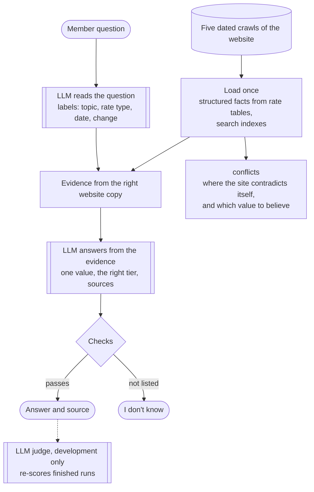

# Dupaco knowledge system

Answers credit-union members' questions from five dated crawls of the Dupaco website. Each answer gives the **current**, correctly-tiered value, a source, and an honest "I don't know" when the site does not say. It also lists the places where the website contradicts itself.

Built for the hackathon described in `Knowledge-Hackathon-Assignment.pdf`.

## Start here

- [Run the project](#run-it): install dependencies and run the public evaluation.
- [`NOTES.md`](NOTES.md): how it works, how "current" is decided, the key decisions, the results and the known limits.
- [`workflow.md`](workflow.md): diagrams of loading, answering one question, and listing contradictions.
- [NOTES.md - Section 6: Evaluation and the LLM judge](NOTES.md#6-evaluation-including-the-llm-judge): how answers are evaluated, including the LLM judge (`my_solution/judge_eval.py`), a stand-in for the scorer's optional judge.
- [NOTES.md - Section 9: Reference mismatches and scoring quirks](NOTES.md#9-reference-mismatches-and-scoring-quirks): public questions that score below full marks because the benchmark and the website disagree, or because of how the scorer works (for example, a question with no `must_include` facts scores 0.0 without the judge).
- [`judge-workflow.md`](judge-workflow.md): the LLM-as-a-judge workflow as diagrams, kept separate from the answering flow.

## Run it

Python 3.11 and an OpenAI API key (see `NOTES.md`, section 1, for the models and the cost).

```bash
pip install -r my_solution/requirements.txt
export OPENAI_API_KEY=<your key>
python harness/run_eval.py --submission my_solution --eval eval/public_eval.jsonl
```

- The harness unpacks the website crawls from `snapshots_zip/` on the first run. That folder is not in this repo, because the data is for the hackathon only. Put the five zips there first. `snapshots/README.md` describes each crawl.
- Loading takes about 3 minutes and about $0.10. A full run of the 40 public questions then costs a few cents.
- A single run sits inside the model's run-to-run noise, so compare changes over three runs.

## What is in the repo

```
my_solution/        the submission: solution.py with build(), plus a few development tools (see NOTES.md, section 6)
harness/            the organizers' scorer and a tiny selftest fixture
eval/               the 40 public questions, and further question sets in eval/subsets/
docs/gold/          hand-made answer sheets for conflicts(), and how to score them
docs/prompt_tuning/ the LLM-assisted prompt-tuning rounds and what came out of them
starter/            the organizers' naive baseline
```

## At a glance



Boxes with double edges are calls to an LLM. The details are in [`NOTES.md`](NOTES.md), [`workflow.md`](workflow.md) and [`judge-workflow.md`](judge-workflow.md).
