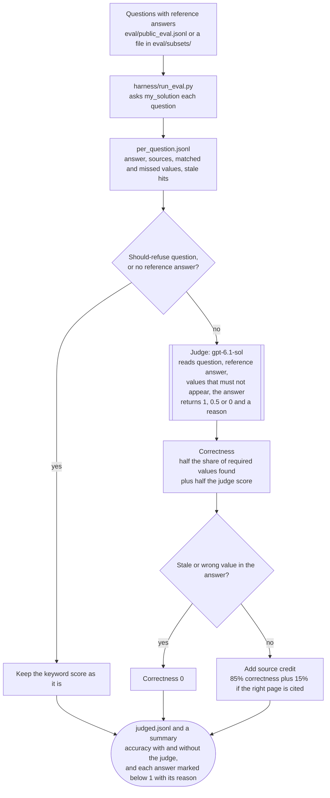
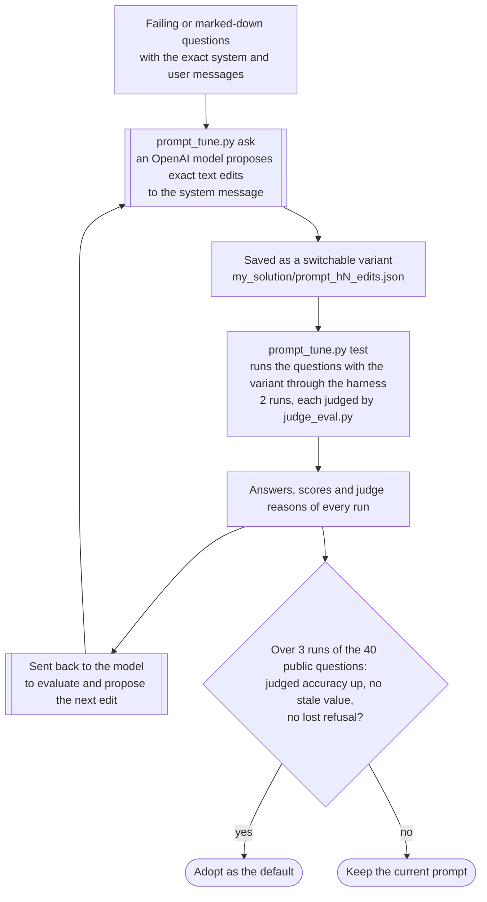

# LLM-as-a-judge workflow

How answers are judged during development. This is separate from the day-to-day answering flow in [`workflow.md`](workflow.md): nothing here runs when the system answers a question, and the grader never calls it.

## Why a judge

The harness scores an answer by matching required values, which is strict and cheap but cannot tell a complete answer from a bare one. The organizers' scorer has an optional judge for that (`harness/run_eval.py --judge`, an Anthropic model, `claude-opus-5-5`). The stand-in in `my_solution/judge_eval.py` uses an OpenAI model (`gpt-6.1-sol`, reasoning effort low) so a run can be re-scored without asking the questions again. It uses the same question wording, the same 1 / 0.5 / 0 scale and the same 50/50 blend as the harness. It is a stand-in and not a prediction of the organizers' score. It is used to compare two versions and to read why an answer was marked down.

## 1. Judging one finished run



- A question with no required values is scored by the judge alone.
- If the judge call fails for one answer, that answer keeps its keyword score.
- The judge never changes a should-refuse question.

```bash
python harness/run_eval.py --submission my_solution --eval eval/public_eval.jsonl --out results/run1
python my_solution/judge_eval.py --results results/run1/per_question.jsonl --eval eval/public_eval.jsonl
```

Result on the public set: judged accuracy about 0.81 to 0.82, against 0.85 from keyword matching. The answers are short on purpose, and the judge sometimes wants extra detail such as a minimum deposit.

## 2. Using the judge to tune the prompt



- Nothing becomes the default by itself. A variant is switched on with `MY_SOLUTION_PROMPT_VARIANT=H1` and so on.
- Outcome of the three rounds so far: no edit helped reliably without costing a refusal, so the current prompt stayed. The rounds and the questions they used are in `docs/prompt_tuning/`.
