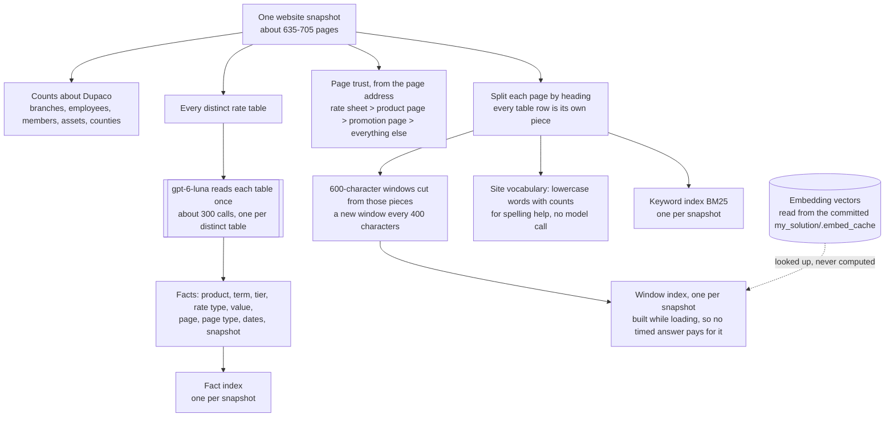
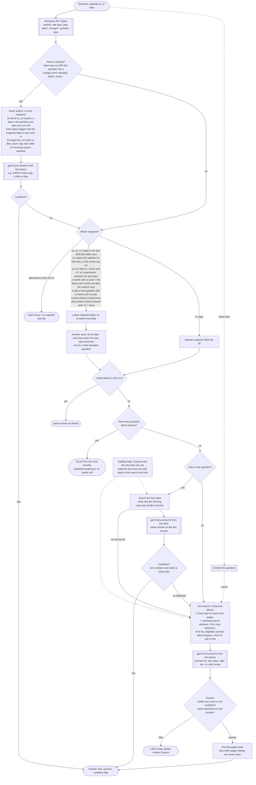

# Workflow

How the submission in `my_solution/` works, as three diagrams that follow the code: loading the snapshots (`ingest`),
answering one question (`answer`), and listing contradictions (`conflicts`). The written description is in `NOTES.md`.

## 1. Loading the snapshots (`ingest`, once per snapshot, untimed)

The scorer calls `ingest` five times, oldest snapshot first.

The windows are cut from the same pieces the keyword index uses, so a window can lose the heading that says what it is (the lobby-hours miss,
dup-104). Nothing is embedded during `ingest` in the default mode: the vectors were built beforehand and are committed, and the window index
is assembled from them while loading. A window whose vector is not in the file is never embedded while answering; if any window of a snapshot is
missing, window search is switched off for that snapshot with no warning, and the question gets keyword pieces only. The vectors cover all five
website copies. If the snapshots change, they must be rebuilt (the build script is not part of this hand-in).

## 2. Answering one question (`answer`, timed)

Boxes with double edges are calls to OpenAI. Answer calls ask for OpenAI's faster service tier and are retried once on the default tier if the account refuses it. A normal question makes three: the labels, the question's embedding (sent at the same
time as the labels) and one answer call. A rate or fee question the rate tables don't answer makes a fourth, when it falls back to
text search. A count question ("how many branches") is answered by code, with no answer call. The question's embedding is sent for every
question but is only used when windows are searched (not for a rate or fee question, and not when the vectors are missing).

## 3. Listing contradictions (`conflicts`, once at the end)

Only the newest snapshot is read. A value that changed between snapshots, with no old copy left in the newest one, is history,
not a conflict, and is not listed.

