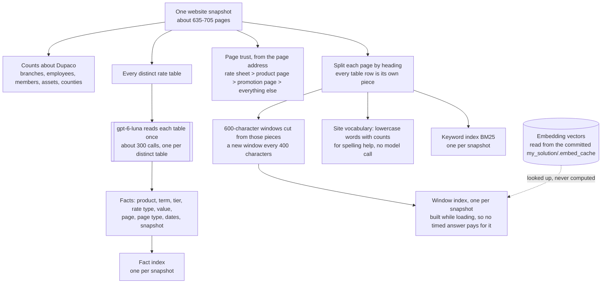
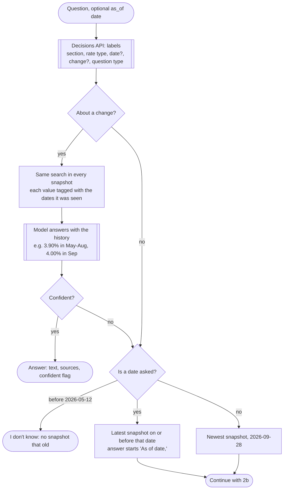
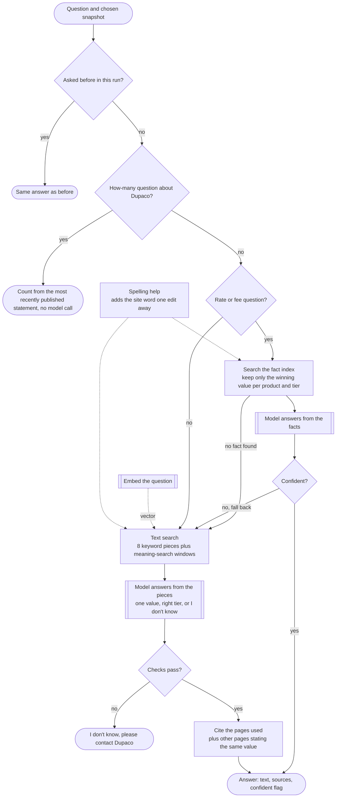
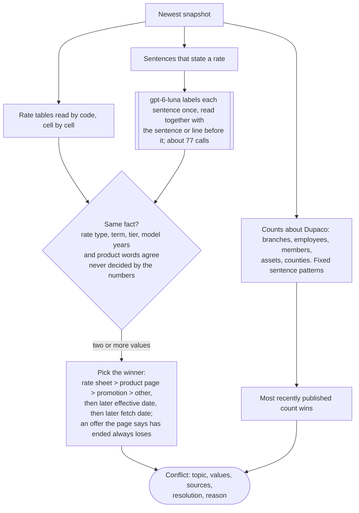

# Workflow

How the submission in `my_solution/` works, as diagrams that follow the code: loading the snapshots (`ingest`),
answering one question (`answer`), and listing contradictions (`conflicts`). The written description is in `NOTES.md`.

## 1. Loading the snapshots (`ingest`, once per snapshot, untimed)

The scorer calls `ingest` five times, oldest snapshot first.

The windows are cut from the same pieces the keyword index uses, so a window can lose the heading that says what it is (the lobby-hours miss,
dup-104). Nothing is embedded during `ingest` in the default mode: the vectors were built beforehand and are committed, and the window index
is assembled from them while loading. A window whose vector is not in the file is never embedded while answering; if any window of a snapshot is
missing, window search is switched off for that snapshot with no warning, and the question gets keyword pieces only. The vectors cover all five
website copies. If the snapshots change, they must be rebuilt (the build script is not part of this hand-in).

## 2. Answering one question (`answer`, timed)

Boxes with double edges are calls to OpenAI. Answer calls ask for OpenAI's faster service tier and are retried once on the default tier if the account refuses it. A normal question makes three calls: the labels, the question's embedding (sent at the same time as the labels) and one answer call. A rate or fee question the rate tables don't answer makes a fourth, when it falls back to text search. A count question ("how many branches") is answered by code, with no answer call. The embedding is only used when windows are searched, so not for a rate or fee question, and not when the vectors are missing.

### 2a. Which website copy answers

- **A change question** is one where the label says so and the question has a change word such as changed, before or since. The search is cut off at `as_of` if one is given; a date written in the question does not cut it off. For page text, not rates or fees, each copy also adds its meaning-search windows.
- **A date is asked** when `as_of` is given, or when the question contains a date and either the label says it is about the website on that date or the words say so ("as of", "back in", "at the end of", or a past-tense question on any topic).
- **A month with no year** means the latest such month not after the newest copy. A rate or fee question with a month and no year counts as dated even without a past-tense verb, unless it looks forward (will, if I, next).
- **A dated answer** starts "As of <date>," and says when the year was assumed. A change question does not get that start, because its date is the start of a comparison.

### 2b. How the answer is produced

- **Text search** keeps 8 keyword pieces, with 2 slots reserved for lower-trust pages, and adds meaning-search windows: 3 for most questions, 6 for list, eligibility and fact-about-Dupaco questions, none for rate or fee questions.
- **Spelling help:** a typed word the site does not use adds the site word one edit away, to the search text only. The model still sees the question as typed.
- **The checks** turn the answer into the standard refusal when the model says it cannot answer, or when a value was asked for and the answer has no new number. On the facts path, a failed check also counts as "not confident", so the text search runs.

## 3. Listing contradictions (`conflicts`, once at the end)

Only the newest snapshot is read. A value that changed between snapshots, with no old copy left in the newest one, is history,
not a conflict, and is not listed.

